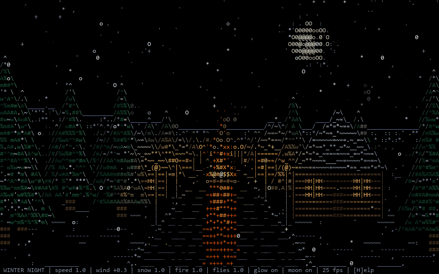

# ascii-winter-night

An animated ASCII winter night for your terminal. A snowy village lane in
one-point perspective: pines, cabins with lit windows, street lamps, a bonfire
with sparks and smoke, a moon, drifting snow and fireflies.



One Python file, standard library only.

## Run

```
python winter.py
```

Needs Python 3.8+ and a terminal with ANSI colour (Windows Terminal, iTerm2,
kitty, GNOME Terminal, and so on). A bigger window and a smaller font give a
more detailed picture; the scene redraws itself when you resize.

## Keys

| Key | Action |
| --- | --- |
| up / down | animation speed |
| left / right | wind |
| `s` / `S` | less / more snow |
| `f` / `F` | smaller / bigger fire |
| `e` / `E` | fewer / more fireflies |
| `g` | toggle glow (firelight and lamplight) |
| `m` | toggle moon |
| `r` | new random scene |
| space | pause |
| `h` | help |
| `q` | quit |

## Options

```
python winter.py --seed 7 --snow 2 --wind -1 --fire 1.5
```

| Option | Meaning |
| --- | --- |
| `--seed N` | pick the scene (default: random each run) |
| `--fps N` | target frame rate (default 25) |
| `--speed`, `--wind`, `--snow`, `--fire`, `--flies` | starting values for the live controls |
| `--no-glow`, `--no-moon` | start with glow or moon off |
| `--color auto\|truecolor\|256\|mono` | colour mode (default: auto-detect) |
| `--size 120x40` | force a size instead of using the terminal's |

## How it works

- The static picture (sky, hills, ground, trees, cabins, lamps) is drawn once
  per scene into a character buffer, far to near, with a depth value per cell.
- Every snowflake has its own depth. It is hidden by anything nearer than
  itself, and its size, brightness, fall speed and wind drift follow from that
  depth, which gives the parallax.
- The bonfire is a small heat grid: heat is injected along the bottom row and
  each cell takes a randomly offset, slightly cooled copy of the cell below it.
- Firelight and lamplight are precomputed weight maps that tint whatever is
  under them, including snowflakes passing through.

## Regenerating the preview

`tools/render_preview.py` renders frames to a GIF or PNG without a terminal.
It needs [Pillow](https://python-pillow.org/):

```
pip install pillow
python tools/render_preview.py --gif docs/preview.gif --png docs/preview.png
```

## License

MIT
